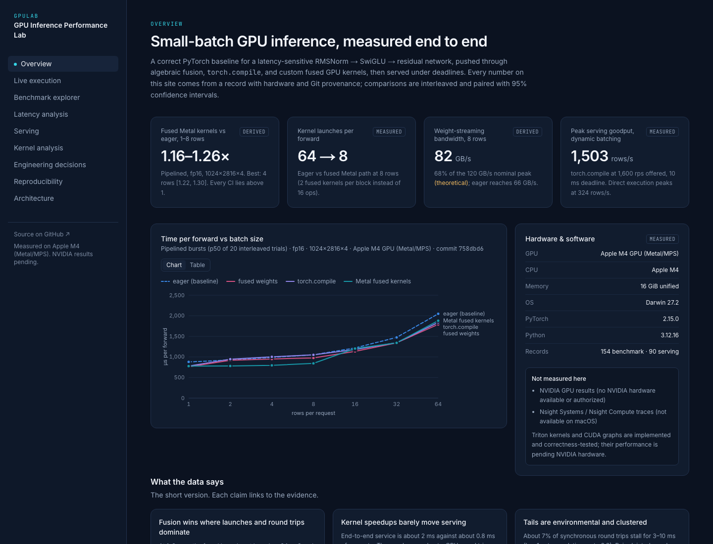
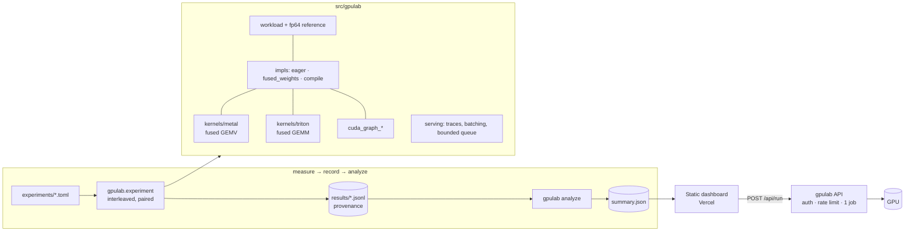

# GPU Inference Performance Lab

[](https://github.com/Gnanasudharsan/gpu-inference-performance-lab/actions/workflows/ci.yml)

**A reproducible lab for small-batch, latency-sensitive GPU inference.** It starts from a correct
PyTorch baseline, finds the bottleneck by measurement, removes it with fused GPU kernels, and serves
the result under deadlines. Every number comes from a record with hardware, software and Git
provenance. Every comparison is interleaved, paired, and reported with a 95% confidence interval.

**Live dashboard:** https://gpu-inference-performance-lab.vercel.app. It shows recorded
measurements, and its Live page runs real paired measurements on a hosted backend. That backend is a
free Modal CPU container, labeled as such; point the page at your own GPU backend for GPU results.



> **Hardware honesty.** The kernel work was developed and measured on an **Apple M4** (10-core GPU
> via Metal/MPS, plus CPU). The NVIDIA paths (Triton kernels, CUDA graphs, `reduce-overhead`) were
> then measured on a **free Kaggle Tesla T4**: one session whose correctness gate passed with 289 tests
> on the GPU ([NVIDIA_T4.md](docs/NVIDIA_T4.md)). It is a shared, virtualized, launch-bound host with
> no bf16. Its numbers describe that setup, not data-center GPUs in general.

## Why this problem

Real-time inference with models smaller than LLMs is rarely FLOP-bound. At 1–8 rows a forward pass
does about 1–8 FLOPs per byte of weights it reads, so its floor is *weight bytes ÷ memory bandwidth*.
In practice, eager execution sits well above that floor. It pays a fixed cost for each of 64 kernel
launches per forward, and it round-trips intermediates through memory. This is the regime where
launch overhead, fusion, CUDA graphs, and the difference between throughput and *goodput* decide the
outcome. The workload is a stack of pre-norm **RMSNorm → SwiGLU → residual** blocks (1024×2816×4,
34.6 M parameters, 69 MB in fp16), the feed-forward core of most modern models
([WORKLOAD.md](docs/WORKLOAD.md)).

## Results (Apple M4 GPU via MPS, PyTorch 2.15.0)

Method: pipelined time per forward, fp16, 1024×2816×4; 20 interleaved trials, rotated order, paired
ratios, bootstrap 95% CI. Records are in `results/phase3/` (commit `758dbd6`).

| rows | eager µs | **fused Metal kernels** | speedup [95% CI] |
|---|---|---|---|
| 1 | 879 | 778 | **1.16× [1.11, 1.23]** |
| 2 | 927 | 780 | **1.21× [1.16, 1.26]** |
| 4 | 989 | 795 | **1.26× [1.22, 1.30]** |
| 8 | 1,053 | 845 | **1.20× [1.14, 1.27]** |
| 16 | 1,220 | 1,204 | 1.00× [0.94, 1.06]: no significant difference |
| 64 | 2,048 | 1,881 | 1.10× [1.07, 1.13] |

| What changed | Evidence |
|---|---|
| Kernel launches per forward: **64 → 8** at ≤ 8 rows | profiler plus instrumented launchers (measured) |
| Weight-streaming bandwidth at 8 rows: **65.8 → 81.9 GB/s** (55% → 68% of the 120 GB/s nominal peak) | derived from measured time; the peak is *theoretical* |
| Small model (512×1408×4): **1.66× [1.52, 1.81]** at 1 row | fixed costs dominate more |
| Kernel v2 over v1 at 8 rows: **1.67×** (v1 had *regressed* to 0.77× eager) | interleaved A/B, v1 loaded from Git history |
| Independent re-runs replicate the result: 8 rows **1.205× → 1.210× → 1.209×** | [repro check](results/phase5/repro_comparison.json), [regression gate](results/phase8/perf_regression.json) |
| Serving, 10 ms deadline: dynamic batching peaks at **1,503 rows/s** goodput; direct execution at **324** | open-loop replay ([SERVING.md](docs/SERVING.md)) |
| Bursty arrivals: dynamic batching has the lowest miss rate for every implementation (13.5–19.5% vs 57–69% for direct) | measured |

**Regressions, reported with the same rigor:**
- `torch.compile` on CPU is 0.63–0.78× at 1–8 rows.
- `fused_weights` on CPU is 0.79× at 8 rows.
- The first Metal kernel was 0.77× at 8 rows.
- `torch.compile` on MPS is mostly indistinguishable from eager.

All 248 comparisons (Apple M4 and T4) are in [results/ANALYSIS.md](results/ANALYSIS.md).

**The whole-system finding:** the 1.2× kernel speedup barely moves end-to-end serving. A served
request costs ~2 ms (H2D copy, forward, synchronizing D2H), against ~0.8 ms of compute, and ~7% of
synchronous GPU round trips stall for 3–10 ms on this machine. On this platform the next lever is
the host↔GPU round trip, not the kernel ([ENGINEERING_REPORT.md](docs/ENGINEERING_REPORT.md)).

## Results (NVIDIA Tesla T4 on Kaggle, torch 2.11 + CUDA 13.0)

Same method and workload: fp16, 1024×2816×4, 8 rows, pipelined; commit `36e9026`
([NVIDIA_T4.md](docs/NVIDIA_T4.md), `results/gpu/kaggle-t4-20261110-1753/`).

| Implementation | µs per forward | speedup vs eager [95% CI] |
|---|---|---|
| eager (baseline) | 948 | 1.00× |
| **eager + CUDA graph** | 481 | **1.98× [1.96, 1.99]** |
| fused weights | 551 | 1.70× [1.67, 1.73] |
| torch.compile | 594 | 1.55× [1.46, 1.60] |
| **my Triton fused kernels** | 2,340 | **0.38× [0.36, 0.41]: slower** |

- **The T4 host is launch-bound.** Nsight shows eager's 60 kernels per forward take 606 µs inside a
  948 µs forward. CUDA-graph replay removes the CPU launch cost and doubles speed. The gain shrinks
  with model size: 2.35–2.59× at d=512, 1.00–1.13× at d=2048.
- **The Triton kernel is GPU-bound and slow.** CUDA graphs don't help it, and Nsight puts the time
  inside its two kernels: about 24–34 GB/s, against about 168 GB/s for cuBLAS. The likely cause is
  under-occupancy at small M (8–88 programs on 40 SMs, no split-K); that is a hypothesis, not yet
  confirmed with Nsight Compute.
- **`reduce-overhead` regresses as the model grows** (2.99× → 0.36–0.41×). Profiles show two extra
  copy kernels per forward, consistent with Inductor copying the weights into its CUDA-graph buffers
  on every replay. This is a diagnosis; the fix is not yet measured.
- **Real hardware found seven bugs**, including a CUDA-graph lifetime bug and Triton re-autotuning
  in the middle of serving (p99 12.7 s → 10 ms after the fix). All are listed in
  [NVIDIA_T4.md](docs/NVIDIA_T4.md#bugs-that-only-real-nvidia-hardware-exposed).

## Architecture



| Module | Responsibility |
|---|---|
| `workload`, `correctness` | deterministic weights/inputs, float64 reference (cross-checked against NumPy), calibrated tolerances |
| `impls`, `kernels/metal.py`, `kernels/triton_kernels.py` | execution modes behind one interface; fused kernels |
| `bench`, `stats`, `profiling` | latency / e2e / pipelined timing, interleaving, CIs, autocorrelation, launch counts |
| `serving` | seeded open-loop traces, direct/static/dynamic batching, bounded queue, failure isolation |
| `experiment`, `analysis`, `summary` | TOML runner, paired comparisons with verdicts, evidence-labeled dataset |
| `api` | bounded, authenticated, rate-limited live-benchmark service |
| `web/` | Next.js static dashboard (9 sections, accessible SVG charts) |

## The optimization, briefly

1. **Measure first.** Eager issues 16 ops per block, and only 3 of them are GEMMs
   ([PROFILING.md](docs/PROFILING.md)).
2. **Algebraic fusion** (`fused_weights`): packed gate‖up GEMM, native `rms_norm`, residual via
   `addmm`. This cuts launches 64 → 20 and helps modestly.
3. **`torch.compile`.** Neutral on MPS, where the GEMMs dominate and stay vendor GEMMs. A regression
   on CPU.
4. **Fused Metal GEMV kernels** (`kernels/metal.py`). RMSNorm is folded in by linearity,
   `(s·x⊙g)W = s·((x⊙g)W)`. Lanes stream each weight row once, with 4-wide coalesced loads,
   reducing with `simd_sum`. The SiLU·mul and residual epilogues are fused: **2 kernels per block**.
   v2 specializes per row count and reuses each activation load across columns. The launch config
   is tuned by measurement. Above 8 rows the path hands GEMMs back to MPS, where the crossover was
   measured.
5. **Triton** (`kernels/triton_kernels.py`) applies the same fusion to tiled `tl.dot` GEMMs. Σx²
   accumulates inside the K-loop, there are two accumulators, fp32 uses `input_precision="ieee"`, and
   configs are autotuned. **CUDA graphs** wrap either path for stable shapes. On the T4, CUDA graphs
   are the biggest win (1.98×) and the Triton kernel is a measured loss (0.38×); see above.

Rejected alternatives and their reasons are in [DECISIONS.md](docs/DECISIONS.md). Examples:
- a full transformer workload
- estimating CUDA numbers
- a general Metal GEMM
- hand-written PTX without hardware to validate it
- closed-loop load generation

## Correctness guarantees

- Every implementation is compared against a **float64 CPU reference**. That reference is itself
  validated against an independent NumPy implementation.
- Errors are scale-normalized (relative L2, max error ÷ max |ref|). Tolerances sit 3–10× above the
  baseline's *measured* error per dtype ([CORRECTNESS.md](docs/CORRECTNESS.md)).
- The checker is shown to catch injected bugs: swapped weights, a missing residual, a wrong ε, and
  permuted rows.
- Coverage spans every device × dtype, with edge shapes (1 row, odd rows, non-power-of-two widths),
  strided inputs and leading dims. Repeated execution must be bitwise stable.
- The benchmark harness **refuses to time** an implementation that fails correctness.
- Triton runs under `TRITON_INTERPRET=1` in CI and passes in fp32/fp16. bf16 is blocked by a
  reproducible Triton-interpreter bug (`tests/test_triton_bf16_diagnostic.py`, strict xfail). On the
  real T4 the full suite is a gate: benchmarks run only if it passes (289 passed; bf16 is unsupported
  below sm_80).

## Measurement methodology

Full details are in [BENCHMARK_METHODOLOGY.md](docs/BENCHMARK_METHODOLOGY.md). In brief:

- **Timing:** synchronize before stopping the host timer; device events run in a separate pass,
  because events were measured to perturb host latency on MPS.
- **Warm-up and isolation:** warm-up by count and by time (clock ramp); GC disabled in timed loops.
- **Drift and noise:** trials are interleaved in rotated order (separate runs differed by up to
  2.2×); lag-1 autocorrelation is checked before trusting bootstrap CIs; power and thermal state is
  recorded.
- **Serving:** an open-loop discrete-event replay that reports its own fidelity (wake-up lateness).

## Reproduce

```bash
git clone https://github.com/Gnanasudharsan/gpu-inference-performance-lab && cd gpu-inference-performance-lab
make install && make check                      # lint (incl. security rules), mypy, 228 tests
.venv/bin/gpulab env                            # provenance report
.venv/bin/gpulab run --device mps --dtype float16 --rows 8 --impl metal      # one checked forward
.venv/bin/gpulab bench --interleave --impls eager metal --rows 1 8 --modes throughput --trials 20
.venv/bin/gpulab experiment experiments/apple_m4.toml     # full matrix (~25 min on an M-series Mac)
.venv/bin/gpulab experiment experiments/nvidia.toml       # on a CUDA host
scripts/kaggle_run.sh                                     # or: the T4 session on Kaggle's free tier
.venv/bin/gpulab analyze                                  # results/summary.json + ANALYSIS.md
.venv/bin/python scripts/perf_regression_check.py         # GPU perf regression gate
cd web && npm ci && npm run build                         # dashboard from your data
.venv/bin/gpulab serve                                    # live API for the dashboard's Live page
```

See [REPRODUCIBILITY.md](docs/REPRODUCIBILITY.md) for per-phase commands.

## Deployment and costs

- **Dashboard:** a static export on Vercel's Hobby tier (no cost), with security headers. Verified
  by `scripts/deploy_frontend.sh`.
- **GPU execution API:** packaged as `deploy/Dockerfile` (non-root, healthcheck) and
  `deploy/modal_app.py`, with these caps:
  - one L4, one request at a time
  - a 120 s timeout and scale-to-zero
  - secrets in the provider store
  - a workspace spend limit
- **The GPU API is not deployed.** That needs GPU-cloud credentials and an agreed budget.
  Reported serverless L4 pricing is about $0.80/h, billed per second; re-verify before use.
- **Controls:** auth, rate limiting, enumerated inputs, a CORS allowlist and hashed logs.
  [DEPLOYMENT.md](docs/DEPLOYMENT.md) covers the controls, cold-start caveats and the checklist.

## Interview discussion points

- Why small-batch inference is a bandwidth and launch problem, and how the roofline numbers show it.
- How folding RMSNorm into the GEMM by linearity removes a pass and a launch, and what it does to
  rounding.
- The v1 → v2 kernel story: a real regression, its cause (activation reloads and runtime-bounded
  accumulators), and the fix.
- Why separate benchmark runs can't be compared on a noisy machine, and how interleaved, paired
  trials with CIs made the conclusions replicate three times.
- Throughput vs goodput: static batching's low-load failure, and why dynamic batching needs slack
  margins.
- The whole-system lesson: kernel wins that do not survive the host↔GPU round trip.
- What the T4 changed: on a slow host, CUDA graphs beat every kernel change, and my Triton kernel
  lost to cuBLAS. Real hardware also exposed seven bugs that CPU-only CI could not see.
- What I would do next on a GPU: Nsight Compute on the Triton kernels at M ≤ 16 to test the
  occupancy hypothesis, then split-K; and the static-weights fix for `reduce-overhead`.

A 5- and 20-minute walkthrough is in [docs/interview-walkthrough.md](docs/interview-walkthrough.md).
The audit is in [docs/final-audit.md](docs/final-audit.md).

## Documentation

[Research alignment](docs/research-alignment.md) · [Environment](docs/ENVIRONMENT.md) ·
[Workload](docs/WORKLOAD.md) · [Correctness](docs/CORRECTNESS.md) ·
[Benchmark methodology](docs/BENCHMARK_METHODOLOGY.md) · [Profiling](docs/PROFILING.md) ·
[Kernels](docs/KERNELS.md) · [Serving](docs/SERVING.md) ·
[NVIDIA T4 results](docs/NVIDIA_T4.md) · [Engineering report](docs/ENGINEERING_REPORT.md) · [Dashboard](docs/DASHBOARD.md) ·
[Deployment](docs/DEPLOYMENT.md) · [Decisions](docs/DECISIONS.md) ·
[Known limitations](docs/KNOWN_LIMITATIONS.md) · [Phase status](docs/PHASE_STATUS.md) ·
[Final audit](docs/final-audit.md)

## License

MIT. See [LICENSE](LICENSE). This project is independent and not affiliated with any employer. It
uses synthetic workloads only.
