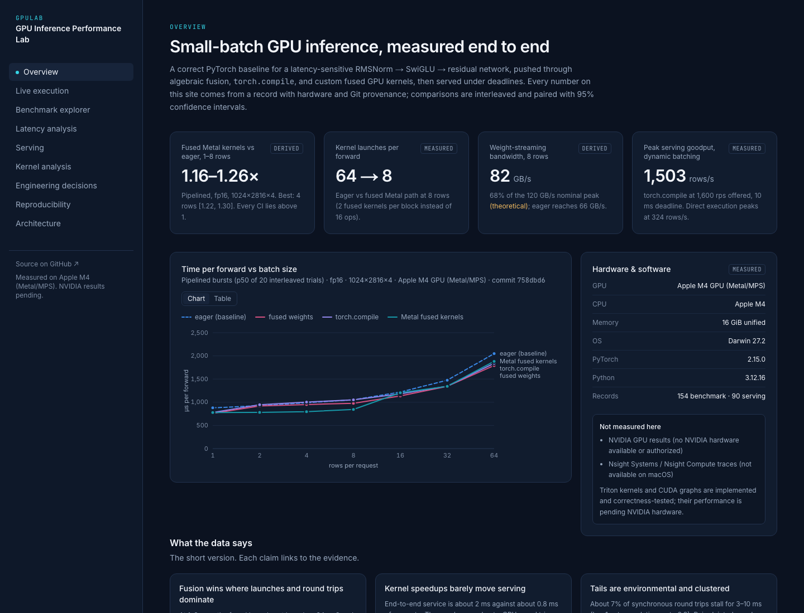
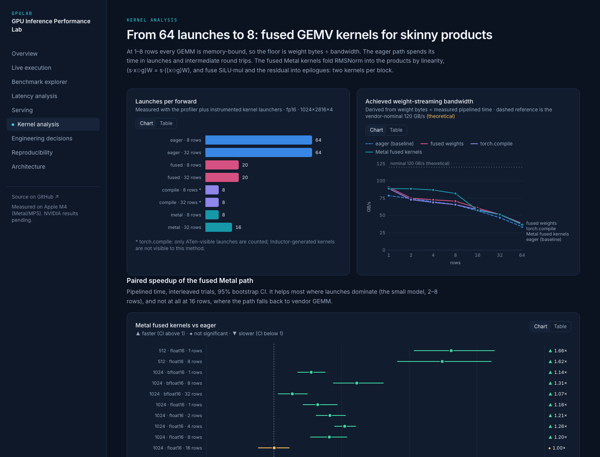
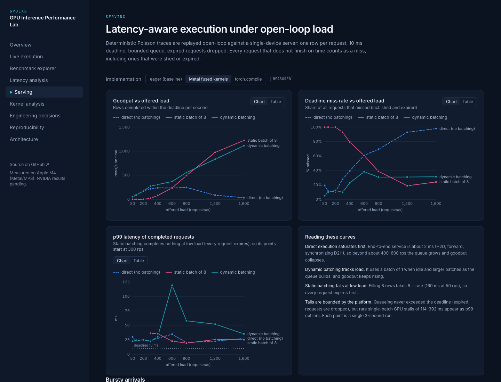
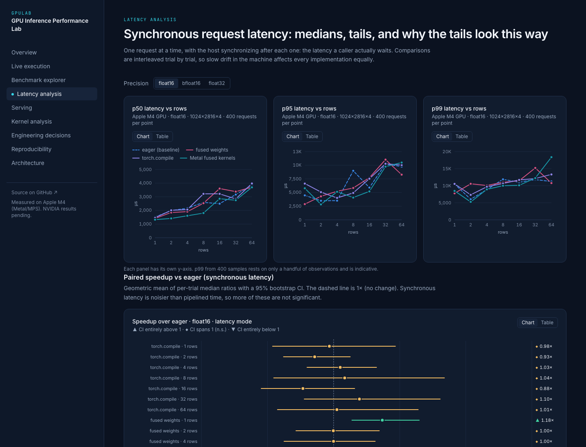

# Dashboard

Code: [`web/`](../web). The dashboard is a static Next.js export that reads one dataset,
`results/summary.json` (built by `gpulab analyze`), plus an optional live API
([`src/gpulab/api.py`](../src/gpulab/api.py)).

## Stack and why

| Choice | Why | Rejected |
|---|---|---|
| Next.js 16 static export (`output: "export"`) | Typed React, file-based routes, and output that is plain files any static host serves (Vercel, GitHub Pages, S3). Nothing to operate | A server-rendered app: there is nothing dynamic to render server-side |
| Tailwind CSS 4 with design tokens in `@theme` | One place for the palette; consistent spacing; no CSS-in-JS runtime | A component library: its visual language would fight the brief |
| Hand-written SVG charts (`web/components/charts.tsx`) | Exact control over marks, CI whiskers, tooltips, keyboard access and the validated palette; zero chart dependencies | Recharts or Chart.js: heavier, and harder to make precise and accessible |
| FastAPI service for live runs | The Python package does the measuring, so the API is a thin, bounded wrapper | Running measurement code in the browser or in serverless JS: there is no GPU there |

The dependency list is three runtime packages (`next`, `react`, `react-dom`) plus Tailwind and
TypeScript.

## Honesty rules enforced in the UI

- Recorded numbers come only from `summary.json` and carry evidence tags (`measured`, `derived`,
  `theoretical`). Headline tiles are computed from the dataset at runtime, not typed in.
- Live results come only from a backend response with `evidence: "live"`, and they show the device,
  timestamp and commit. When no backend is reachable, the page says *offline*, and no recorded data
  is substituted.
- Speedups always show their 95% CI and a verdict (▲ faster / ◆ not significant / ▼ slower). A
  1.13× result whose CI spans 1 is shown as not significant.
- The build fails if `results/summary.json` is missing (`web/scripts/sync-data.mjs`). There are no
  placeholder datasets.

## Color

Categorical series (implementations) were validated with the dataviz validator against the chart
surface `#111C2E`:

```
node validate_palette.js "#3987e5,#d55181,#9085e9,#1798a8" --mode dark --surface "#111C2E"
  [PASS] Lightness band   [PASS] Chroma floor   [PASS] CVD separation (worst adjacent ΔE 9.3)
  [PASS] Normal-vision floor (worst adjacent ΔE 16.7)   [PASS] Contrast vs surface (all ≥ 3:1)
```

- The brief's cyan `#36D6E7` is too light for a series on this surface (OKLCH L 0.80), so it is
  used for UI accents only. The series uses the in-band step `#1798a8`.
- Blue and violet fail the *all-pairs* check, which matters where all four lines overlap. The eager
  baseline is therefore always **dashed**, and lines are direct-labeled (secondary encoding).
- Emerald, amber and coral are reserved for verdict status, always paired with an icon and a label.
- Text contrast on the surfaces (WCAG): primary 15.8:1, secondary 7.2:1, muted 5.0:1 (4.56:1 on
  elevated cards), accent button 10.6:1.

## Accessibility and responsiveness (checked)

The following was checked on all 9 pages in the browser:

- one `h1`, `lang="en"`
- 0 form controls without labels
- 0 nameless buttons or links
- every chart `svg[role=img]` has an `aria-label`
- no horizontal page scroll at 1280 px or 375 px

Every chart has a **Table** view, and line charts support arrow-key crosshair navigation. There is a
skip link, `aria-current` navigation, `prefers-reduced-motion` support, skeleton loading states, and
error states with retry.

## Run

```bash
gpulab analyze                       # refresh results/summary.json
cd web && npm ci && npm run build    # -> web/out (static)
python3 -m http.server 4310 --directory web/out
GPULAB_CORS_ORIGINS=http://localhost:4310 .venv/bin/gpulab serve --port 8000   # optional live API
```

Set `NEXT_PUBLIC_API_URL` at build time to point the Live page at a deployed API by default. Users
can also enter another URL on the page; it is stored only in their browser.

## Screenshots (real application, Apple M4 data)

| | |
|---|---|
|  |  |
|  |  |
